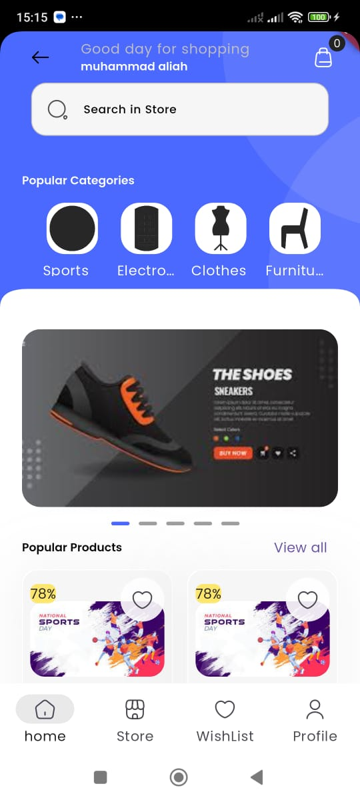
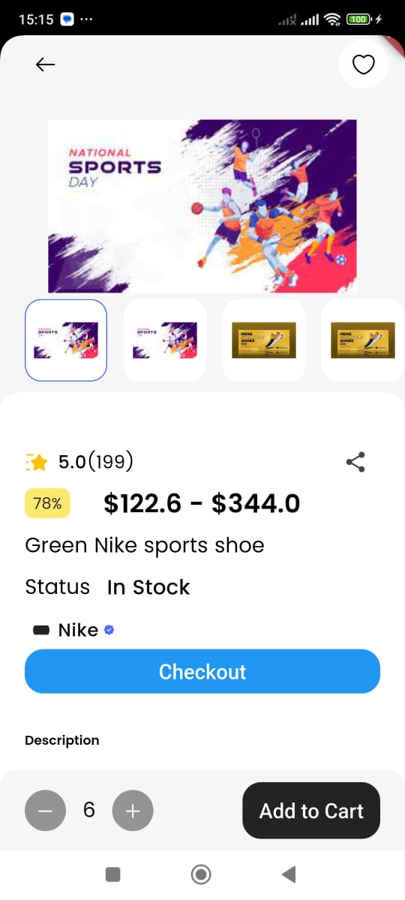
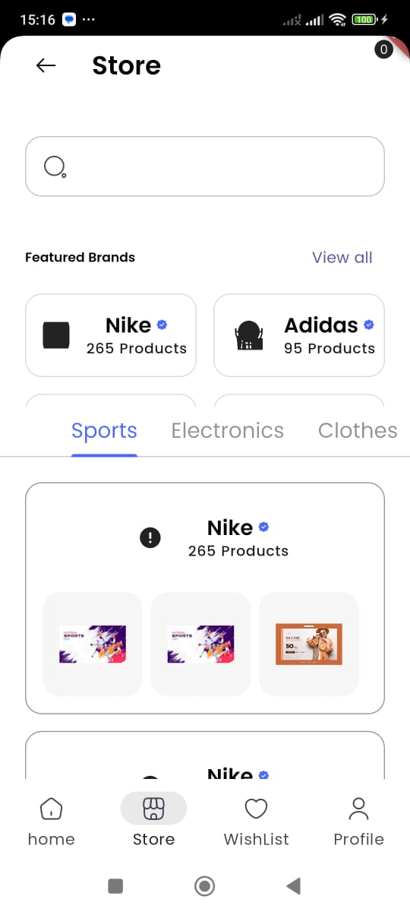
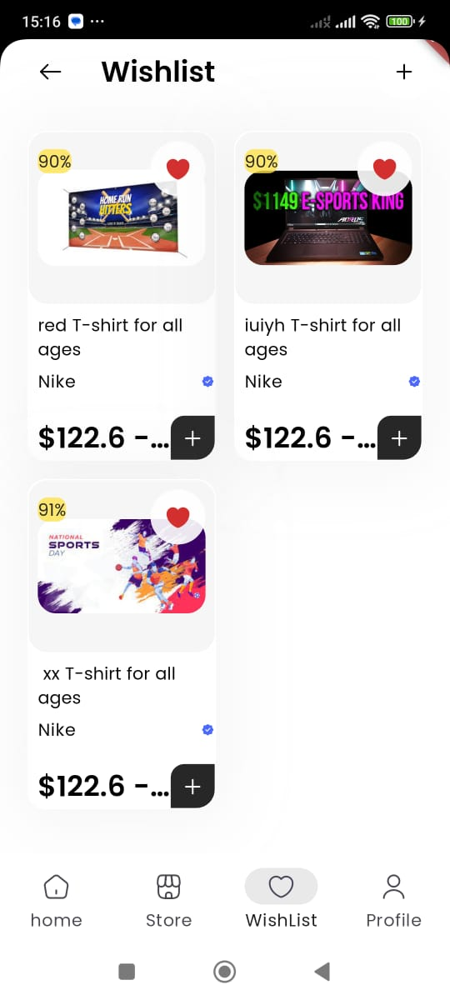
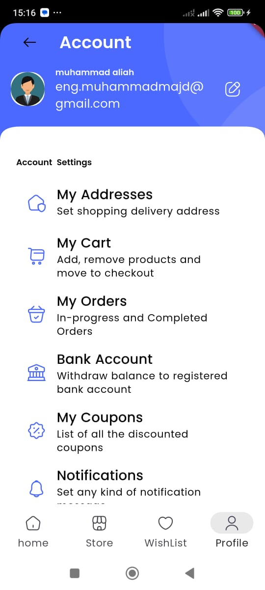
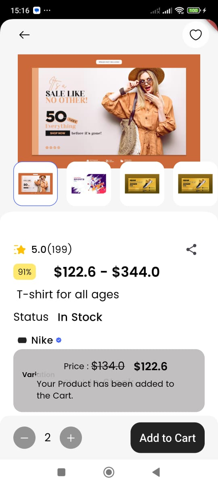
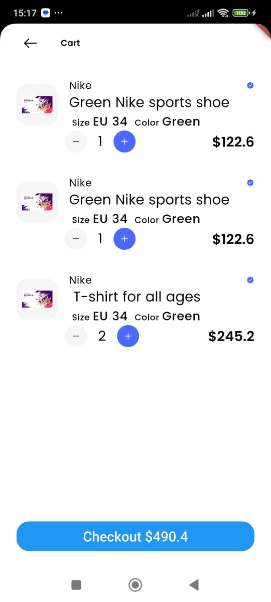

# 🛍️ M-Shop — Flutter E-Commerce App

M-Shop is a Flutter-based e-commerce mobile application that allows customers to browse products, explore categories, apply filters, manage wishlists, view product details, and shop online through a convenient mobile interface.

## ✨ Features

- 🏠 **Home Screen** — Browse and discover products.
- 🗂️ **Categories** — Explore products by category.
- 🔎 **Product Filtering** — Find products based on your preferences.
- ❤️ **Wishlist** — Save favorite products for later.
- 👤 **Account** — Access your account section.
- 📦 **Product Details** — View detailed product information.
- 🛒 **Shopping Cart** — Manage selected products before checkout.

## 📱 Screenshots

<table>
  <tr>
    <td align="center" width="50%">
      <strong>Home Screen</strong><br/>
      
    </td>
    <td align="center" width="50%">
      <strong>Categories</strong><br/>
      
    </td>
  </tr>
  <tr>
    <td align="center" width="50%">
      <strong>Product Filtering</strong><br/>
      
    </td>
    <td align="center" width="50%">
      <strong>Wishlist</strong><br/>
      
    </td>
  </tr>
  <tr>
    <td align="center" width="50%">
      <strong>Account</strong><br/>
      
    </td>
    <td align="center" width="50%">
      <strong>Product Details</strong><br/>
      
    </td>
  </tr>
  <tr>
    <td align="center" width="50%">
      <strong>Shopping Cart</strong><br/>
      
    </td>
    <td width="50%"></td>
  </tr>
</table>

## 🚀 Getting Started

### Prerequisites

- Flutter SDK
- Dart SDK
- Android Studio or Visual Studio Code
- An Android emulator, iOS simulator, or physical device

### Installation

1. Clone the repository:

   ```bash
   git clone <YOUR_REPOSITORY_URL>
   ```

2. Navigate to the project directory:

   ```bash
   cd M-Shop
   ```

3. Install dependencies:

   ```bash
   flutter pub get
   ```

4. Run the application:

   ```bash
   flutter run
   ```

## 🛠️ Built With

- **Flutter** — Cross-platform mobile application development
- **Dart** — Application programming language

## 📚 Resources

- [Flutter Documentation](https://docs.flutter.dev/)
- [Write Your First Flutter App](https://docs.flutter.dev/get-started/codelab)
- [Flutter Cookbook](https://docs.flutter.dev/cookbook)

---

*Built with Flutter to deliver a convenient mobile shopping experience.*
